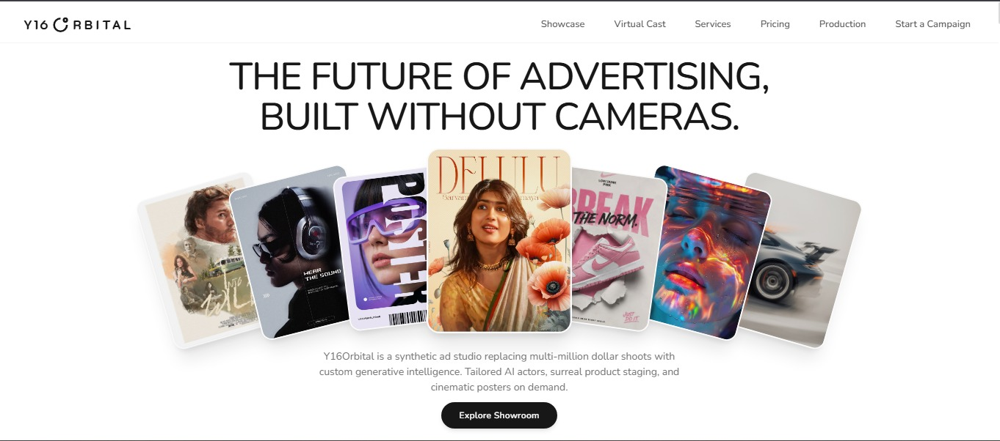

  

    

  **AI-Powered Creative Production Studio — Built for the Next Generation of Advertising.**

    

  
  
  
  
  
  

    

  

    <a href="https://y16orbital.vercel.app/"><strong>Explore the Live Experience →</strong></a>
  

   

  

 

---

## ✦ Overview

**Y16Orbital** is an Awwwards-tier animated web portfolio built for a speculative high-fashion and commercial generative AI studio. Engineered from the ground up to push the boundaries of modern creative front-end performance, the site pairs editorial typography and hyper-detailed campaign renders with a unified physics-based smooth scrolling and timeline animation pipeline.

Zero physical cameras. Infinite fidelity. Y16Orbital showcases high-fashion capsules, hardware CGI, virtual casting, and on-demand commercial direction.

---

## ✦ Cinematic Feature Highlights

### 1. Dual-Phase Pinned Hero Landing (`HeroLanding.jsx`)
- **Phase 1: 7-Card Fanout**: A pinned opening sequence scrubbing 7 high-fashion cards from an overlapping center stack into a cinematic 180° arc.
- **Phase 2: E-Commerce Morph**: Continues scrubbing to translate, scale, and rotate cards into a clean 3D isometric commercial showcase while editorial titles transition smoothly.

### 2. Gateway & Interactive Billboard (`Section3Gateway.jsx`)
- **Cursor Trail Engine**: Object-pooled interactive cursor trail (`POOL_SIZE: 6`) that spawns ephemeral lookbook artworks with natural rotation and zero memory leaks.
- **Scroll Parallax Upward Glide**: 130% bounded background imagery moving with vertical parallax as the visitor scrolls through the section.
- **Seamless Infinite Marquee**: Seamless double-buffered brand ticker looping smoothly with infinite duration.

### 3. Sprout & Stack Engine (`Section4Sprout.jsx`)
- **Scrubbed Inline Text Morph**: Headings dynamically scramble and morph character-by-character using `ScrambleTextPlugin`.
- **Responsive Fanout Stack**: 4 cards sprout sequentially from the text stream and settle into stacked editorial coordinates with dedicated mobile viewport offsets.

### 4. Sine-Wave Wavy Showcase (`Section5WavyShowcase.jsx`)
- **Continuous Sine-Wave Matrix**: Dual infinite horizontal marquees running in counter directions with mathematical vertical sine-wave phase offsets (`y = sin(x) * A`), eliminating loop seam jumps.

### 5. Asymmetrical Project Showcase (`Section6ProjectShowcase.jsx`)
- **Scrubbed Text Reveal**: Editorial headlines scrub word-by-word from blur and low opacity to pristine sharpness.
- **Dynamic Project Stages**:
  - Interactive Prada lookbook card fan with hover spread.
  - Cobalt electric 3D spatial staging with fluid responsive bounds.
  - Pop gen-AI brand acceleration banner.
  - Obsidian luxury tech render with hover rotation triggers.

### 6. 3D Perspective Hero Matrix (`Section7PerspectiveHero.jsx`)
- **100% Full-Bleed Billboard**: Starts as a full-viewport landscape billboard with dual-stage upward parallax matching Section 3.
- **Scrubbed 3D Contract**: Shrinks into a centered portrait card as a 15-card 3D perspective matrix (`3 rows × 5 columns`) flies forward along the Z-axis with real-time viewport bounds calculation.

### 7. Studio Pricing & Circular Overlays (`Section8Pricing.jsx`)
- **Zero-Height-Shift Billing Engine**: Dynamic monthly/yearly pricing calculations with a locked savings slot to prevent vertical layout shifts or scroll jumping.
- **Radial Clip-Path Overlays**: Interactive `"View all"` buttons trigger expanding circular reveal modals (`[clip-path:circle(...)]`) displaying comprehensive SLAs, credit rollover policies, and commercial buyouts.

### 8. Full-Bleed Editorial Footer (`Footer.jsx`)
- **5-Stage Sequential Reveal**: Background arrival, animated scaleX line drawing, staggered link group entrance, fluid clamped wordmark, and legal bar.
- **Background Upward Parallax**: Continuous scrubbed vertical parallax gliding from `yPercent: +8%` to `-8%`.
- **Directional Hover Physics**: Left-side links nudge $+8\text{px}$ right, right-side links nudge $-8\text{px}$ left.

---

## ✦ Engineering & Performance Standards

- **Unified Scroll Ticker Loop**: GSAP ScrollTrigger and Lenis smooth scroll run inside a single, synchronized `gsap.ticker` loop with zero lag smoothing during motion (`lagSmoothing(0)`), preventing scroll desync.
- **Mobile URL Bar Resize Protection**: `ScrollTrigger.config({ ignoreMobileResize: true })` paired with innerWidth-only resize debounce listeners prevents mobile browser address bars from triggering layout reflows and scroll snap jumps.
- **No Pin Margins**: Strict adherence to GSAP pinning guidelines — all spacing between pinned triggers is handled via internal padding to preserve calculated pin spacers.
- **Accessibility & Motion Safety**: Every animated section listens to `(prefers-reduced-motion: reduce)` to immediately present fully settled layouts without disorienting motion.
- **Clean Responsive Separation**: All responsive breakpoints and spacing values are organized in `media.css` under explicit Mobile ($\le 768\text{px}$) and Desktop ($\ge 769\text{px}$) queries.

---

## ✦ Tech Stack

| Technology | Purpose |
| :--- | :--- |
| **React 19** | Modern component architecture, state management & reactive rendering |
| **Vite 6** | Ultra-fast build toolchain & production bundler |
| **GSAP 3** | High-performance animation runtime (`ScrollTrigger`, `ScrambleTextPlugin`, `useGSAP`) |
| **Lenis** | Smooth momentum-based physics scrolling engine |
| **Tailwind CSS v4**| Modern styling engine with zero-runtime CSS variables |
| **Lucide React** | Lightweight editorial interface icons |
| **Vercel** | Edge network deployment & asset CDN |

---

## ✦ Live Deployment

The project is continuously deployed on Vercel:
👉 **[https://y16orbital.vercel.app/](https://y16orbital.vercel.app/)**

---

## ✦ License

Distributed under the MIT License. See `LICENSE` for more information.

 

  Designed & Developed for Y16 Orbital © 2026. All commercial rights reserved.

